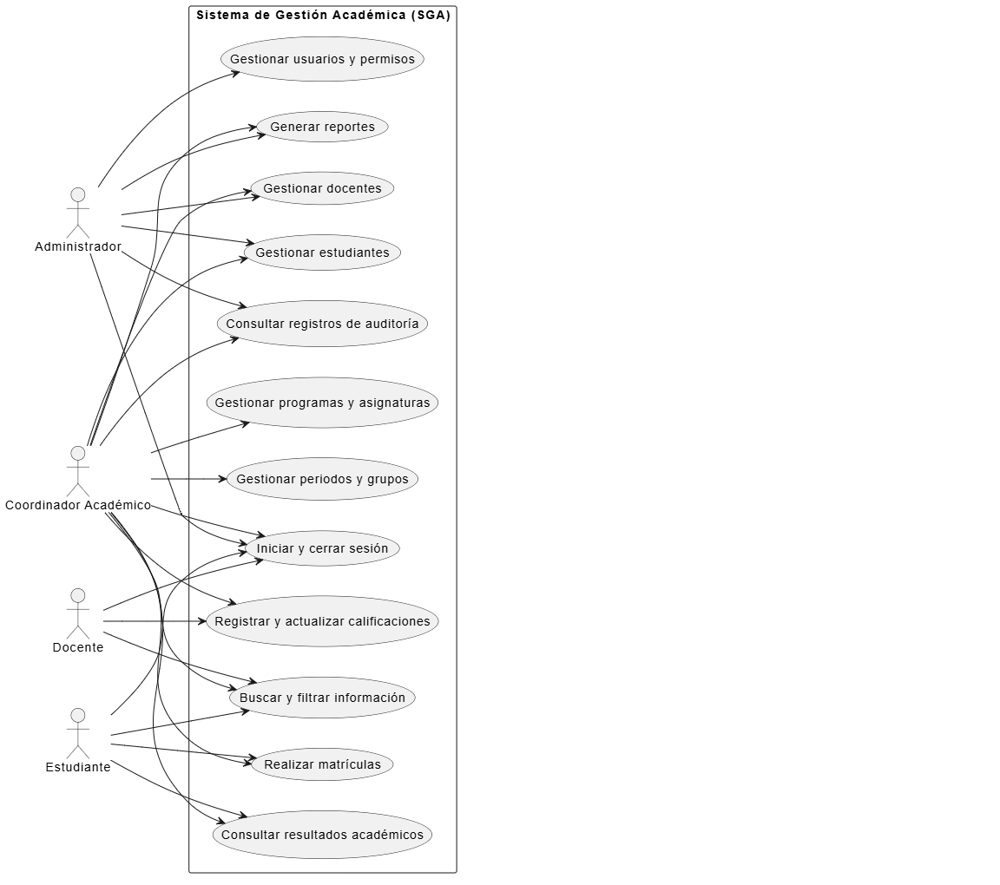
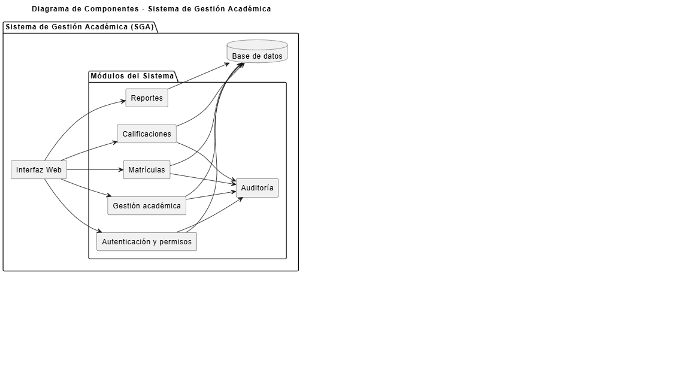
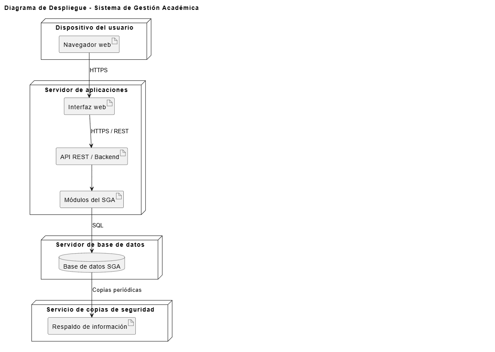
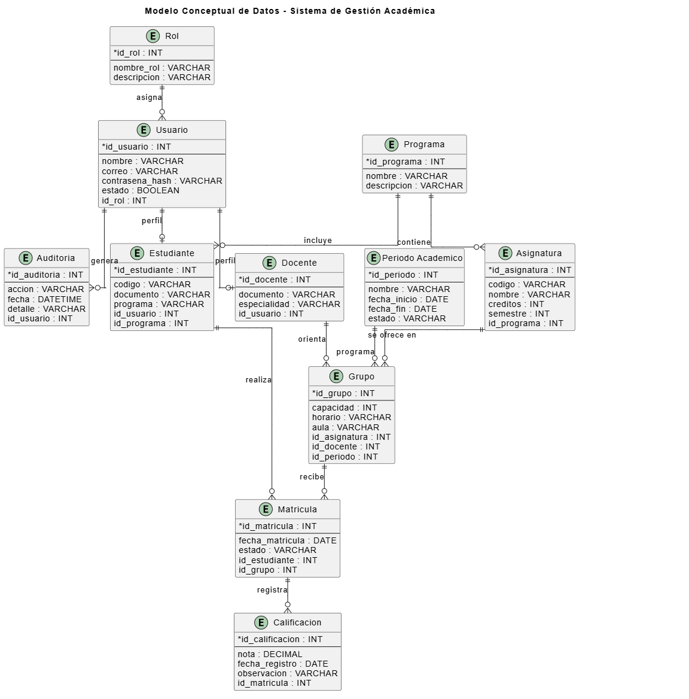
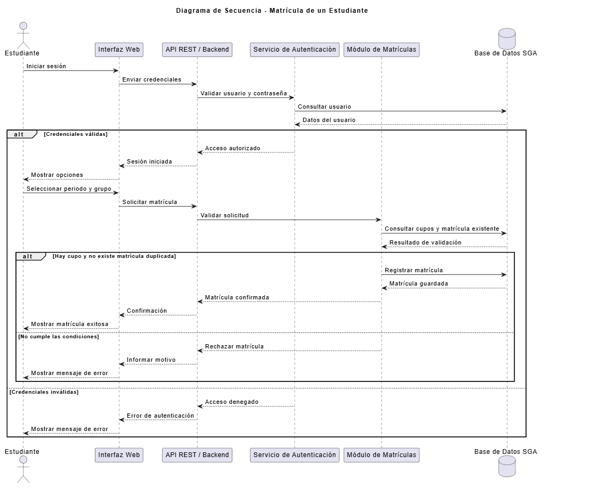

# Introducción

Las instituciones de educación superior gestionan diariamente información relacionada con estudiantes, docentes, programas académicos, asignaturas, grupos, matrículas y calificaciones. Cuando esta información se encuentra distribuida en diferentes archivos y aplicaciones, pueden presentarse problemas de duplicidad, demoras en las consultas y dificultades para realizar un seguimiento adecuado de los procesos académicos.

Por esta razón, se propone el diseño de una arquitectura de software para un Sistema de Gestión Académica (SGA), cuyo propósito es centralizar y organizar la información institucional mediante una solución accesible desde un navegador web, segura y preparada para crecer de acuerdo con las necesidades de la institución.

En este proyecto se identifican los requerimientos funcionales y no funcionales, se definen los actores y las responsabilidades del sistema, y se plantea una arquitectura modular organizada por capas. Además, se elaboran diferentes modelos para representar su estructura, funcionamiento, componentes y relaciones de datos.

Como herramienta de apoyo se utiliza Google AI Studio para generar y analizar propuestas arquitectónicas, cuyos resultados son revisados y ajustados de acuerdo con los requerimientos y el alcance del proyecto.

# Objetivos

## Objetivo general

Diseñar y modelar una propuesta de arquitectura de software para un Sistema de Gestión Académica, a partir de la identificación de requerimientos funcionales y no funcionales, utilizando Google AI Studio como herramienta de apoyo para generar, analizar y refinar la solución arquitectónica.

## Objetivos específicos

- Identificar el problema organizacional y las necesidades relacionadas con la gestión de la información académica.
- Definir los requerimientos funcionales y no funcionales del sistema.
- Identificar los actores, sus responsabilidades y las reglas de negocio principales.
- Proponer una arquitectura de software modular que facilite la organización y el mantenimiento del sistema.
- Elaborar los diagramas de casos de uso, componentes, despliegue, modelo conceptual de datos y secuencia.
- Construir una matriz de trazabilidad que relacione los requerimientos con los componentes y mecanismos de validación.
- Analizar los riesgos y atributos de calidad de la arquitectura propuesta.
- Utilizar Google AI Studio de manera crítica para apoyar el diseño y evaluar sus recomendaciones.

# Alcance del proyecto

El proyecto comprende el diseño y modelado de una propuesta arquitectónica para un Sistema de Gestión Académica orientado a centralizar los principales procesos académicos de una institución de educación superior.

La propuesta contempla los módulos de autenticación y permisos, gestión académica, matrículas, calificaciones, reportes y auditoría. También incluye la definición de los requerimientos, los modelos arquitectónicos, la matriz de trazabilidad y el análisis de riesgos.

El alcance se concentra en el diseño conceptual y arquitectónico del sistema. Por lo tanto, no se contempla la implementación completa de todas las funcionalidades ni su puesta en producción. El prototipo desarrollado tiene un propósito demostrativo y permite evidenciar algunos aspectos iniciales de autenticación y control de permisos.

# 1. Análisis del problema

## 1.1 Contexto del problema

Actualmente, la institución de educación superior presenta dificultades en la gestión de su información académica, debido a que los datos de estudiantes, docentes, programas, asignaturas, grupos, matrículas y calificaciones se encuentran distribuidos en diferentes archivos y aplicaciones.

Esta situación genera duplicidad de información, consultas lentas, dificultades para realizar seguimiento académico y poca trazabilidad de las operaciones realizadas.

Por esta razón, se propone diseñar un Sistema de Gestión Académica (SGA) que permita centralizar la información en una plataforma web, facilitando su administración, consulta y actualización de manera segura y organizada.

## 1.2 Necesidades identificadas

El sistema debe permitir:

- Administrar la información de estudiantes y docentes.
- Gestionar programas académicos y asignaturas.
- Configurar periodos, grupos, horarios y docentes asignados.
- Realizar matrículas de estudiantes.
- Registrar y consultar calificaciones.
- Generar reportes académicos.
- Controlar el acceso según los roles de usuario.
- Mantener un registro de las operaciones importantes.

## 1.3 Actores del sistema

Se identifican cuatro actores principales:

- **Administrador:** administra usuarios, roles y la información general del sistema.
- **Coordinador académico:** gestiona programas, asignaturas, periodos, grupos y matrículas.
- **Docente:** consulta sus grupos y registra o actualiza calificaciones.
- **Estudiante:** consulta sus asignaturas, horarios, matrículas y calificaciones publicadas.

## 1.4 Restricciones y supuestos

**Restricciones:**

- El sistema debe funcionar mediante un navegador web.
- El acceso debe estar protegido mediante autenticación.
- Cada usuario tendrá permisos de acuerdo con su rol.
- La información académica y personal debe protegerse.
- Las operaciones deben conservar la integridad de los datos.

**Supuestos:**

- La institución proporcionará la información necesaria para alimentar el sistema.
- Los usuarios tendrán acceso a internet y a un navegador actualizado.
- Cada usuario contará con credenciales individuales.
- La institución definirá las reglas académicas para matrículas y calificaciones.

## 1.5 Reglas de negocio iniciales

- Un usuario solamente podrá acceder a las funciones autorizadas para su rol.
- Un estudiante no podrá matricularse dos veces en el mismo grupo y periodo.
- No se podrán realizar matrículas cuando se haya alcanzado la capacidad del grupo.
- Los docentes solamente podrán registrar calificaciones de los grupos que tengan asignados.
- Los estudiantes únicamente podrán consultar sus propios resultados académicos.
- Las operaciones importantes deberán quedar registradas para facilitar su seguimiento.

# 2. Identificación y clasificación de requerimientos

## 2.1 Requerimientos funcionales

Los requerimientos funcionales describen las acciones y servicios que debe ofrecer el Sistema de Gestión Académica para satisfacer las necesidades de la institución.

| Código | Requerimiento | Descripción |
|---|---|---|
| RF-01 | Autenticación | El sistema permitirá que los usuarios inicien y cierren sesión mediante credenciales individuales. |
| RF-02 | Roles y permisos | El sistema manejará los roles de administrador, coordinador académico, docente y estudiante, restringiendo las funciones según los permisos asignados. |
| RF-03 | Gestión de estudiantes | Permitirá crear, consultar, actualizar y desactivar registros de estudiantes. |
| RF-04 | Gestión de docentes | Permitirá crear, consultar, actualizar y desactivar registros de docentes. |
| RF-05 | Programas y asignaturas | Permitirá crear y actualizar programas académicos, planes de estudio y asignaturas. |
| RF-06 | Grupos y periodos | Permitirá configurar periodos académicos, grupos, cupos, docentes asignados, horarios y espacios o enlaces de reunión. |
| RF-07 | Matrículas | Permitirá matricular estudiantes en asignaturas y grupos, validando los cupos disponibles y evitando matrículas duplicadas. |
| RF-08 | Gestión de calificaciones | Permitirá que los docentes registren y actualicen las calificaciones de los estudiantes inscritos en sus grupos. |
| RF-09 | Consulta de resultados | Permitirá que los estudiantes consulten sus asignaturas, horarios y calificaciones publicadas. |
| RF-10 | Reportes | Permitirá generar reportes de estudiantes matriculados, grupos, asignaturas y resultados académicos. |
| RF-11 | Búsqueda y filtros | Permitirá buscar y filtrar información por identificadores, nombres, programa, periodo y estado. |
| RF-12 | Auditoría | Registrará eventos importantes, como inicios de sesión, cambios de roles, matrículas y modificaciones de calificaciones. |

Estos requerimientos permitirán establecer las funcionalidades principales del sistema y servirán como base para diseñar sus módulos y componentes.

## 2.2 Requerimientos no funcionales

Los requerimientos no funcionales establecen las condiciones de calidad, seguridad, rendimiento y funcionamiento que debe cumplir el Sistema de Gestión Académica.

| Código | Requerimiento | Descripción |
|---|---|---|
| RNF-01 | Seguridad | El sistema utilizará conexiones HTTPS, protegerá las contraseñas y controlará el acceso mediante roles y permisos. |
| RNF-02 | Rendimiento | El 95 % de las consultas comunes deberá responder en un máximo de 3 segundos, con hasta 300 usuarios concurrentes en el escenario de referencia. |
| RNF-03 | Disponibilidad | El sistema tendrá un objetivo de disponibilidad mensual igual o superior al 99,5 %, excluyendo los mantenimientos programados y anunciados. |
| RNF-04 | Escalabilidad | Permitirá aumentar los recursos de procesamiento para atender el crecimiento de usuarios, periodos, cursos y registros sin rediseñar todo el sistema. |
| RNF-05 | Mantenibilidad | La arquitectura separará responsabilidades y facilitará las pruebas, correcciones y futuras modificaciones. |
| RNF-06 | Usabilidad y accesibilidad | Tendrá una interfaz adaptable a computadores y dispositivos móviles, con etiquetas claras, contraste suficiente y navegación mediante teclado en las funciones principales. |
| RNF-07 | Integridad y consistencia | Las matrículas y calificaciones validarán las reglas del negocio y conservarán la consistencia de los datos ante errores o solicitudes simultáneas. |
| RNF-08 | Interoperabilidad | Dispondrá de interfaces documentadas, preferiblemente mediante una API REST, para facilitar futuras integraciones institucionales. |
| RNF-09 | Copias de seguridad y recuperación | Contará con copias de seguridad periódicas y un procedimiento de restauración ante posibles fallos. |
| RNF-10 | Trazabilidad | Las decisiones de arquitectura y los requerimientos estarán relacionados con componentes, interfaces, modelos y evidencias de validación. |
| RNF-11 | Privacidad | Los datos personales y académicos estarán protegidos y solo serán accesibles para los usuarios autorizados según sus funciones. |
| RNF-12 | Compatibilidad | La aplicación funcionará en navegadores web actuales y se adaptará a diferentes tamaños de pantalla. |

Estos requerimientos permitirán evaluar la calidad de la solución arquitectónica y establecer criterios para verificar que el sistema cumpla las condiciones esperadas.

# 3. Matriz de trazabilidad de requerimientos

La matriz de trazabilidad permite relacionar los requerimientos funcionales y no funcionales del Sistema de Gestión Académica (SGA) con los módulos de la arquitectura, los modelos elaborados y los mecanismos propuestos para verificar su cumplimiento.

## 3.1 Trazabilidad de requerimientos funcionales

| Requerimiento | Componente relacionado | Modelo relacionado | Método de verificación |
|---|---|---|---|
| RF-01. Autenticación | Módulo de usuarios y autenticación | Casos de uso, componentes y secuencia | Comprobar inicio y cierre de sesión con credenciales válidas e inválidas. |
| RF-02. Roles y permisos | Módulo de usuarios y permisos | Casos de uso y componentes | Verificar que cada rol acceda únicamente a las funciones autorizadas. |
| RF-03. Gestión de estudiantes | Módulo de gestión académica | Casos de uso y datos | Comprobar creación, consulta, actualización y desactivación de estudiantes. |
| RF-04. Gestión de docentes | Módulo de gestión académica | Casos de uso y datos | Comprobar creación, consulta, actualización y desactivación de docentes. |
| RF-05. Programas y asignaturas | Módulo de gestión académica | Casos de uso y datos | Verificar el registro y actualización de programas y asignaturas. |
| RF-06. Periodos y grupos | Módulo de gestión académica | Casos de uso, componentes y datos | Comprobar la configuración de periodos, grupos, capacidad, docentes y horarios. |
| RF-07. Matrículas | Módulo de matrículas | Casos de uso, datos y secuencia | Verificar la validación de cupos y la prevención de matrículas duplicadas. |
| RF-08. Calificaciones | Módulo de calificaciones | Casos de uso, componentes y datos | Comprobar el registro y actualización de notas por docentes autorizados. |
| RF-09. Consulta de resultados | Módulo de calificaciones | Casos de uso y componentes | 	Verificar que el estudiante consulte únicamente sus asignaturas, horarios y calificaciones publicadas, de acuerdo con sus permisos. |
| RF-10. Reportes | Módulo de reportes | Casos de uso y componentes | Comprobar la generación de reportes por periodo y programa académico. |
| RF-11. Búsqueda y filtros | Módulos de gestión académica y reportes | Casos de uso y componentes | Verificar búsquedas por identificadores, nombres, programa, periodo y estado. |
| RF-12. Auditoría | Módulo de auditoría | Casos de uso, componentes y datos | Comprobar el registro de eventos con identificación del usuario, fecha, acción realizada y registro afectado. |

## 3.2. Trazabilidad de requerimientos no funcionales

| Requerimiento | Componente relacionado | Modelo relacionado | Método de verificación |
|---|---|---|---|
| RNF-01. Seguridad | Autenticación, permisos y backend | Componentes y despliegue | Revisar el uso de HTTPS, almacenamiento de contraseñas mediante mecanismos seguros y control de acceso basado en roles y permisos. |
| RNF-02. Rendimiento | Backend y base de datos | Componentes y despliegue | Realizar pruebas de rendimiento con hasta 300 usuarios concurrentes y verificar que el 95 % de las consultas habituales responda en un máximo de 3 segundos. |
| RNF-03. Disponibilidad | Servidor de aplicaciones y base de datos | Despliegue | Revisar los mecanismos de monitoreo y calcular la disponibilidad mensual, verificando el objetivo del 99,5 %, excluyendo los mantenimientos programados anunciados. |
| RNF-04. Escalabilidad | Backend modular y base de datos | Componentes y despliegue | Evaluar la posibilidad de aumentar los recursos de procesamiento y almacenamiento sin rediseñar todo el sistema. |
| RNF-05. Mantenibilidad | Módulos independientes del SGA | Componentes | Revisar la separación de responsabilidades, la cohesión de los módulos y el bajo acoplamiento entre sus componentes. |
| RNF-06. Usabilidad y accesibilidad | Interfaz web | Componentes y despliegue | Evaluar la claridad de las etiquetas, el contraste, la navegación mediante teclado y la adaptación de la interfaz a computadores y dispositivos móviles. |
| RNF-07. Integridad y consistencia | Matrículas, calificaciones y base de datos | Componentes, datos y secuencia | Probar las reglas de negocio, las transacciones y el comportamiento ante solicitudes simultáneas para evitar registros inconsistentes. |
| RNF-08. Interoperabilidad | API REST / Backend | Componentes y despliegue | Revisar que la API REST tenga interfaces documentadas y permita futuras integraciones con otros sistemas institucionales. |
| RNF-09. Copias de seguridad y recuperación | Base de datos y servicio de copias de seguridad | Despliegue | Verificar la programación de copias de seguridad y realizar pruebas de restauración para comprobar la recuperación de la información. |
| RNF-10. Trazabilidad | Documentación y módulos del SGA | Todos los modelos | Revisar la correspondencia entre requerimientos, componentes, modelos y decisiones arquitectónicas. |
| RNF-11. Privacidad | Autenticación, roles y permisos | Componentes y datos | Verificar que los usuarios únicamente puedan consultar y modificar la información autorizada según su rol y sus permisos. |
| RNF-12. Compatibilidad | Interfaz web | Despliegue | Probar el sistema en navegadores actuales y diferentes tamaños de pantalla para comprobar su correcto funcionamiento y adaptación. |

## 3.3 Análisis de la matriz

La matriz permite comprobar que los requerimientos funcionales y no funcionales tienen relación con los componentes y modelos propuestos para el Sistema de Gestión Académica.

Los requerimientos funcionales se relacionan principalmente con los módulos de autenticación, gestión académica, matrículas, calificaciones, reportes y auditoría. Por su parte, los requerimientos no funcionales se atienden mediante decisiones de seguridad, organización modular, rendimiento, disponibilidad, escalabilidad, integridad y protección de la información.

Los métodos de verificación descritos corresponden a pruebas y revisiones propuestas para validar la arquitectura. Su inclusión no significa que todas estas pruebas hayan sido ejecutadas o que los objetivos de calidad ya estén demostrados.

# 4. Diseño y justificación de la arquitectura de software

## 4.1 Arquitectura seleccionada

Para el Sistema de Gestión Académica (SGA) se propone una arquitectura de tipo monolito modular, organizada mediante capas. Esta arquitectura permite desarrollar y mantener los diferentes módulos del sistema dentro de una misma aplicación, manteniendo separadas sus responsabilidades.

La solución estará organizada en una capa de presentación, una capa de lógica de negocio y una capa de acceso a datos. Esta separación facilita el mantenimiento, las pruebas y la evolución del sistema.

## 4.2 Justificación de la arquitectura

Se seleccionó esta arquitectura porque el Sistema de Gestión Académica necesita centralizar diferentes procesos institucionales, como la administración de usuarios, estudiantes, docentes, matrículas y calificaciones.

El monolito modular permite mantener una estructura organizada sin requerir la complejidad operativa de implementar múltiples servicios independientes. Además, facilita el control de la información y la comunicación entre los módulos.

La organización por capas contribuye al cumplimiento de los requerimientos no funcionales relacionados con la seguridad, mantenibilidad, integridad y escalabilidad.

## 4.3 Organización por capas

La arquitectura propuesta se divide en las siguientes capas:

- **Capa de presentación:** permite la interacción de los usuarios con el sistema mediante una interfaz web.
- **Capa de lógica de negocio:** contiene las reglas y procesos académicos, como matrículas, gestión de estudiantes y registro de calificaciones.
- **Capa de acceso a datos:** administra las operaciones de consulta, almacenamiento y actualización de la información en la base de datos.

Esta organización permite separar las responsabilidades y facilita la modificación de una capa sin afectar innecesariamente las demás.

## 4.4 Módulos principales del sistema

El Sistema de Gestión Académica estará compuesto por los siguientes módulos:

- **Autenticación y permisos:** administra el inicio y cierre de sesión, los usuarios, los roles y los permisos.
- **Gestión académica:** administra estudiantes, docentes, programas, asignaturas, periodos y grupos.
- **Matrículas:** permite registrar matrículas y validar los cupos disponibles y la existencia de registros duplicados.
- **Calificaciones:** permite registrar, actualizar y consultar las calificaciones según los permisos de cada usuario.
- **Reportes:** genera información académica relacionada con estudiantes matriculados, grupos, asignaturas y resultados.
- **Auditoría:** registra las operaciones importantes realizadas dentro del sistema para facilitar su seguimiento.

## 4.5 Funcionamiento general de la arquitectura

El usuario accede al sistema mediante un navegador web. La interfaz envía las solicitudes al backend a través de una API REST utilizando conexiones HTTPS.

El backend valida la autenticación y los permisos del usuario, procesa las reglas del negocio y se comunica con el módulo correspondiente. Cuando se requiere consultar o modificar información, se realizan operaciones sobre la base de datos.

Adicionalmente, se propone implementar copias de seguridad periódicas para proteger la información institucional y facilitar su recuperación ante posibles fallos.

De esta manera, la arquitectura permite centralizar los procesos académicos y mantener una estructura organizada, segura y preparada para futuras mejoras.

# 5. Análisis de calidad y riesgos de la arquitectura

## 5.1 Atributos de calidad

La arquitectura propuesta para el Sistema de Gestión Académica busca cumplir los siguientes atributos de calidad definidos en el modelo ISO/IEC 25010 (ISO, 2023):

**Seguridad:** se propone implementar autenticación mediante credenciales individuales, contraseñas protegidas y control de acceso basado en roles y permisos.

**Rendimiento:** se plantea optimizar las consultas a la base de datos y organizar los procesos para responder eficientemente a las solicitudes de los usuarios. Se establece como objetivo que el 95 % de las consultas comunes responda en un máximo de tres segundos con hasta 300 usuarios concurrentes.

**Disponibilidad:** se propone mantener mecanismos de monitoreo, respaldo y recuperación para alcanzar el objetivo de disponibilidad mensual del 99,5 %.

**Escalabilidad:** la arquitectura modular permitirá ampliar los recursos del servidor y optimizar los componentes a medida que aumente la cantidad de usuarios y registros académicos.

**Mantenibilidad:** la separación por capas y módulos facilitará la identificación de errores, las pruebas y la incorporación de nuevas funcionalidades.

**Integridad de la información:** se aplicarán validaciones y transacciones para evitar matrículas duplicadas, superar los cupos disponibles o registrar información inconsistente.

## 5.2 Riesgos y estrategias de mitigación

| Riesgo | Posible consecuencia | Estrategia de mitigación |
|---|---|---|
| Acceso no autorizado | Exposición de información personal y académica. | Implementar autenticación segura y permisos por roles. |
| Pérdida de información | Pérdida de registros académicos importantes. | Realizar copias de seguridad periódicas y pruebas de restauración. |
| Sobrecarga del servidor | Lentitud o interrupción del servicio. | Monitorear el rendimiento y ampliar los recursos cuando sea necesario. |
| Matrículas duplicadas | Inconsistencias en los registros académicos. | Aplicar validaciones y restricciones en la base de datos. |
| Fallos en la base de datos | Interrupción de consultas y operaciones. | Implementar procedimientos de recuperación y respaldos. |
| Errores en los permisos | Usuarios con acceso a funciones no autorizadas. | Revisar y probar los permisos asignados a cada rol. |

## 5.3 Posibles puntos únicos de falla

En la arquitectura propuesta se identifican algunos elementos que podrían convertirse en puntos únicos de falla:

- **Servidor de aplicaciones:** si deja de funcionar, los usuarios no podrían acceder a los servicios del sistema.
- **Base de datos centralizada:** una interrupción podría afectar las operaciones académicas y las consultas de información.
- **Conexión de red:** los problemas de conectividad podrían impedir el acceso a la plataforma.

Como medidas preventivas se proponen copias de seguridad, monitoreo, procedimientos de recuperación y, en futuras implementaciones, mecanismos de redundancia para los servicios críticos.

## 5.4 Consideraciones de escalabilidad y seguridad

La arquitectura modular permite que el sistema pueda evolucionar de acuerdo con las necesidades de la institución. Si aumenta la cantidad de usuarios, será posible ampliar los recursos de procesamiento y optimizar la base de datos.

En cuanto a la seguridad, se propone proteger las comunicaciones mediante HTTPS, almacenar las contraseñas mediante mecanismos seguros de hash y restringir el acceso a la información según los roles establecidos (OWASP Foundation, s. f.). 

Estas medidas deberán validarse mediante pruebas técnicas durante la implementación del sistema.

### 5.5. Decisiones arquitectónicas justificadas

Para el diseño del Sistema de Gestión Académica se establecieron las siguientes decisiones arquitectónicas:

**1. Selección de una arquitectura monolítica modular por capas.**

Se eligió esta arquitectura porque permite organizar las funcionalidades en módulos independientes dentro de una misma aplicación. Esta alternativa facilita el mantenimiento, reduce la complejidad de desarrollo y resulta adecuada para el alcance académico del proyecto, sin introducir la infraestructura adicional que requeriría una arquitectura de microservicios.

**2. Implementación de una API REST para la comunicación.**

Se propone utilizar una API REST para facilitar la comunicación entre la interfaz web y el backend. Esta decisión permite separar la presentación de la lógica del sistema y facilita futuras integraciones con otros servicios institucionales.

**3. Implementación de control de acceso basado en roles.**

Se propone utilizar un mecanismo de autenticación y autorización mediante roles y permisos. Esta decisión permite restringir el acceso a la información y las funcionalidades según las responsabilidades de administradores, coordinadores académicos, docentes y estudiantes.

**4. Centralización de la información en una base de datos.**

Se propone utilizar una base de datos centralizada para almacenar la información académica. Esto permite mantener la integridad de los registros, reducir la duplicidad de información y facilitar las consultas y operaciones del sistema.

**5. Registro de eventos mediante un módulo de auditoría.**

Se incorpora un módulo de auditoría para registrar las operaciones relevantes realizadas por los usuarios. Esta decisión facilita el seguimiento de las modificaciones y permite mejorar la trazabilidad y el control de la información.

# 6. Uso y evaluación de Google AI Studio

## 6.1 Uso de la herramienta

Para apoyar el diseño de la arquitectura del Sistema de Gestión Académica (SGA), se utilizó Google AI Studio como herramienta de apoyo para generar y analizar propuestas arquitectónicas (Google, s. f.).

Inicialmente, se proporcionó a la herramienta el contexto del problema, los requerimientos funcionales y no funcionales, y los principales objetivos del sistema. Se solicitó una propuesta de arquitectura que permitiera organizar los módulos, responsabilidades y relaciones entre los componentes.

Posteriormente, se solicitó la generación de un modelo de casos de uso que contemplara los cuatro actores principales: administrador, coordinador académico, docente y estudiante. También se pidió relacionar las funcionalidades con los requerimientos establecidos.

## 6.2 Resultados obtenidos

Entre las principales propuestas generadas por Google AI Studio se identificaron:

- Utilizar una arquitectura modular para separar las responsabilidades del sistema.
- Organizar las funcionalidades en módulos de autenticación, gestión académica, matrículas, calificaciones, reportes y auditoría.
- Implementar control de acceso mediante roles y permisos.
- Utilizar interfaces REST para la comunicación entre los componentes.
- Registrar las operaciones importantes mediante un mecanismo de auditoría.
- Aplicar transacciones y validaciones para proteger la integridad de las matrículas y calificaciones.

La herramienta también sugirió funcionalidades adicionales, como asistencia, facturación, certificados y análisis de deserción estudiantil.

## 6.3 Evaluación crítica de las sugerencias

Las respuestas generadas por Google AI Studio fueron revisadas y comparadas con el alcance y los requerimientos definidos para el proyecto.

Se tomaron las siguientes decisiones:

**Sugerencias aceptadas:**

- Organización modular de las funcionalidades.
- Separación de responsabilidades dentro de la arquitectura.
- Control de acceso basado en roles y permisos.
- Uso de interfaces REST.
- Registro de eventos importantes mediante auditoría.

**Sugerencias ajustadas:**

- Se tomó la propuesta de arquitectura modular y se definió un monolito modular organizado por capas, considerando que resulta más sencillo de desarrollar y mantener para el alcance inicial del proyecto.
- Se conservaron las validaciones y transacciones para las matrículas y calificaciones, ajustándolas a las reglas de negocio establecidas.
- Se consideró el uso de mecanismos de seguridad y control de acceso, de acuerdo con los requerimientos no funcionales.

**Sugerencias descartadas o consideradas opcionales:**

- Los módulos de asistencia, facturación y certificados.
- Los análisis de deserción estudiantil.
- La implementación de microservicios, CQRS y réplicas de lectura como parte de la arquitectura inicial.

Estas propuestas no se incorporaron al diseño principal porque no forman parte de los requerimientos obligatorios o podrían aumentar innecesariamente la complejidad del sistema.

## 6.4 Conclusión sobre el uso de la herramienta

Google AI Studio permitió obtener una propuesta inicial y explorar diferentes alternativas para organizar la arquitectura del SGA. Sin embargo, sus resultados no se adoptaron de manera automática.

La propuesta final fue ajustada teniendo en cuenta los requerimientos funcionales y no funcionales, el alcance académico del proyecto y la necesidad de mantener una arquitectura comprensible, segura y escalable.

De esta manera, la inteligencia artificial se utilizó como herramienta de apoyo, mientras que la selección y justificación de las decisiones arquitectónicas se realizó mediante el análisis individual de los resultados obtenidos.

# 7. Modelos del sistema

En esta sección se presentan los modelos que representan la estructura, el funcionamiento y la organización del Sistema de Gestión Académica (SGA). Se incluyen los diagramas de casos de uso, componentes, despliegue, modelo conceptual de datos y secuencia, elaborados utilizando PlantUML (PlantUML, s. f.).

### 7.1. Modelo de casos de uso

El modelo de casos de uso representa las principales funcionalidades del Sistema de Gestión Académica (SGA) y la interacción de los diferentes actores con el sistema, siguiendo la notación UML (Object Management Group, s. f.).

Se identificaron cuatro actores principales:

- **Administrador:** administra los usuarios, los permisos y realiza actividades de supervisión y auditoría.
- **Coordinador académico:** gestiona estudiantes, docentes, programas, asignaturas, periodos académicos, grupos y matrículas. También puede consultar reportes y realizar seguimiento académico.
- **Docente:** consulta la información de sus grupos, registra y actualiza las calificaciones de los estudiantes y utiliza las opciones de búsqueda autorizadas.
- **Estudiante:** inicia sesión, consulta sus resultados académicos y participa en el proceso de matrícula según las funcionalidades y permisos establecidos.

El diagrama contempla doce casos de uso relacionados con la autenticación, administración de usuarios, gestión académica, matrículas, calificaciones, consultas, reportes, búsquedas y auditoría.

Este modelo permite identificar las responsabilidades de cada actor y establecer una visión general de las funcionalidades que debe ofrecer el sistema.

#### Descripción de los casos de uso

| Código | Caso de uso | Actores participantes | Descripción |
|---|---|---|---|
| CU-01 | Iniciar y cerrar sesión | Administrador, coordinador académico, docente y estudiante | Permite ingresar al sistema mediante credenciales individuales y cerrar la sesión. |
| CU-02 | Gestionar usuarios y permisos | Administrador | Permite administrar las cuentas de usuario, asignar roles y establecer permisos de acceso. |
| CU-03 | Gestionar estudiantes | Administrador y coordinador académico | Permite registrar, consultar, actualizar y desactivar la información de los estudiantes. |
| CU-04 | Gestionar docentes | Administrador y coordinador académico | Permite registrar, consultar, actualizar y desactivar la información de los docentes. |
| CU-05 | Gestionar programas y asignaturas | Coordinador académico | Permite crear y actualizar programas académicos, planes de estudio y asignaturas. |
| CU-06 | Gestionar periodos y grupos | Coordinador académico | Permite configurar periodos académicos, grupos, cupos, horarios y docentes asignados. |
| CU-07 | Gestionar matrículas | Coordinador académico y estudiante | Permite gestionar la inscripción de estudiantes en grupos, validando los cupos disponibles y evitando matrículas duplicadas. |
| CU-08 | Gestionar calificaciones | Docente y coordinador académico | Permite registrar y actualizar las calificaciones de los estudiantes matriculados en los grupos asignados. El coordinador puede intervenir en casos excepcionales autorizados. |
| CU-09 | Consultar resultados académicos | Estudiante y coordinador académico | Permite consultar asignaturas, horarios y calificaciones publicadas, de acuerdo con los permisos de cada rol. |
| CU-10 | Generar reportes | Administrador y coordinador académico | Permite consultar información sobre estudiantes matriculados, grupos, asignaturas y resultados académicos. |
| CU-11 | Buscar y filtrar información | Administrador, coordinador académico, docente y estudiante | Permite localizar registros mediante identificadores, nombres, programas, periodos o estados, según los permisos establecidos. |
| CU-12 | Consultar auditoría | Administrador y coordinador académico | Permite revisar los eventos registrados en el sistema para realizar seguimiento de las operaciones. |

Estos casos de uso describen las interacciones principales entre los actores y el Sistema de Gestión Académica. Cada funcionalidad estará disponible de acuerdo con los permisos establecidos para los diferentes roles.

### 7.2. Modelo de componentes

El modelo de componentes representa la organización interna del Sistema de Gestión Académica (SGA), identificando los módulos principales, sus responsabilidades y la forma en que se relacionan entre sí.

La arquitectura propuesta está organizada en los siguientes componentes:

- **Interfaz web:** permite a los usuarios interactuar con el sistema desde un navegador.
- **Autenticación y permisos:** gestiona el inicio de sesión y verifica los permisos de cada usuario según su rol.
- **Gestión académica:** administra la información de estudiantes, docentes, programas, asignaturas, periodos académicos y grupos.
- **Módulo de matrículas:** gestiona la inscripción de estudiantes en los grupos y valida las condiciones correspondientes.
- **Módulo de calificaciones:** permite registrar y actualizar las notas de los estudiantes autorizados.
- **Módulo de reportes:** genera consultas e informes sobre la información académica.
- **Módulo de auditoría:** registra las acciones relevantes realizadas por los usuarios para facilitar el seguimiento de las operaciones.
- **Base de datos:** almacena la información necesaria para el funcionamiento del sistema.

Los componentes se comunican entre sí para garantizar el funcionamiento integrado del SGA. Esta organización permite separar responsabilidades, facilitar el mantenimiento y reducir el acoplamiento entre los módulos.

### 7.3. Modelo de despliegue

El modelo de despliegue representa la distribución física de los componentes del Sistema de Gestión Académica (SGA), identificando los servidores, dispositivos y servicios necesarios para su funcionamiento.

La arquitectura propuesta contempla los siguientes nodos:

- **Dispositivo del usuario:** permite acceder al sistema mediante un navegador web.
- **Servidor de aplicaciones:** aloja la interfaz web, la API REST y los módulos que contienen la lógica del sistema.
- **Servidor de base de datos:** almacena la información de usuarios, estudiantes, docentes, asignaturas, matrículas y calificaciones.
- **Servicio de copias de seguridad:** conserva respaldos periódicos de la información para facilitar su recuperación ante posibles fallos.

La comunicación entre el navegador y el servidor de aplicaciones se realiza mediante HTTPS. La interfaz web se comunica con el backend a través de una API REST, mientras que los módulos acceden a la base de datos mediante consultas SQL.

Este modelo permite comprender cómo se distribuyen los elementos del sistema y cómo se protege la comunicación y la información almacenada.

### 7.4. Modelo conceptual de datos

El modelo conceptual de datos representa las principales entidades que permiten almacenar y organizar la información del Sistema de Gestión Académica (SGA), así como las relaciones existentes entre ellas.

Se identifican las siguientes entidades:

- **Rol:** define el tipo de usuario y sus permisos dentro del sistema.
- **Usuario:** almacena los datos de acceso y la información básica de cada usuario.
- **Estudiante:** contiene la información académica y personal de los estudiantes.
- **Docente:** almacena la información de los profesores registrados.
- **Programa:** representa los programas académicos ofrecidos por la institución.
- **Asignatura:** contiene los datos de las materias, como código, nombre, créditos y semestre.
- **Periodo académico:** identifica los periodos en los que se desarrolla la actividad académica.
- **Grupo:** representa la oferta de una asignatura en un periodo determinado, con su capacidad, horario y docente asignado.
- **Matrícula:** registra la inscripción de un estudiante en un grupo.
- **Calificación:** almacena las notas correspondientes a las matrículas de los estudiantes.
- **Auditoría:** registra las acciones relevantes realizadas por los usuarios.

Las relaciones entre estas entidades permiten mantener organizada la información. Por ejemplo, un estudiante puede realizar varias matrículas, un grupo puede recibir varias matrículas y cada matrícula puede tener una o varias calificaciones.

Este modelo facilita la integridad, organización y trazabilidad de los datos académicos, evitando duplicidades y permitiendo consultar la información de manera estructurada.

### 7.5. Modelo de secuencia

El modelo de secuencia representa el comportamiento del Sistema de Gestión Académica (SGA) durante el proceso de matrícula de un estudiante, mostrando el orden en que interactúan los diferentes componentes.

El proceso comienza cuando el estudiante inicia sesión desde la interfaz web. La solicitud llega al backend, que se comunica con el servicio de autenticación para validar las credenciales mediante una consulta a la base de datos.

Una vez autorizado el acceso, el estudiante selecciona el periodo académico y el grupo en el que desea matricularse. La solicitud es enviada al módulo de matrículas, encargado de verificar que exista disponibilidad de cupos y que el estudiante no tenga una matrícula duplicada.

Si se cumplen las condiciones, el sistema registra la matrícula en la base de datos y confirma la operación al estudiante. En caso contrario, informa el motivo por el cual no fue posible completar el proceso.

Este modelo permite visualizar la secuencia de mensajes, las validaciones y las respuestas del sistema, garantizando que el proceso de matrícula siga las reglas de negocio establecidas.

# 8. Validación de la propuesta arquitectónica

La validación de la propuesta arquitectónica del Sistema de Gestión Académica se realizó mediante la revisión de los requerimientos funcionales y no funcionales, su correspondencia con los componentes definidos y los modelos elaborados.

Se verificaron los siguientes aspectos:

- **Cobertura funcional:** los doce requerimientos funcionales fueron considerados en el diseño de los módulos y en el modelo de casos de uso.
- **Atributos de calidad:** los requerimientos no funcionales fueron relacionados con decisiones arquitectónicas orientadas a garantizar seguridad, rendimiento, disponibilidad, escalabilidad, mantenibilidad e integridad de la información.
- **Coherencia de los modelos:** los diagramas de casos de uso, componentes, despliegue, datos y secuencia representan diferentes perspectivas de una misma propuesta arquitectónica.
- **Trazabilidad:** se estableció una relación entre los requerimientos, los componentes responsables y las formas propuestas para verificar su cumplimiento.
- **Evaluación de la inteligencia artificial:** se revisaron las recomendaciones de Google AI Studio, seleccionando aquellas que se ajustaban al alcance del proyecto y modificando o descartando las que introducían complejidad o funcionalidades adicionales no requeridas.

Esta validación corresponde a una revisión del diseño y de su coherencia documental. No representa pruebas de funcionamiento de un sistema completamente implementado.

Como resultado, se considera que la arquitectura propuesta ofrece una estructura coherente con las necesidades identificadas y constituye una base para el desarrollo futuro del Sistema de Gestión Académica.

# 9. Conclusiones y recomendaciones

## 9.1. Conclusiones

1. El análisis realizado permitió identificar las principales necesidades de una institución de educación superior respecto a la gestión de su información académica, evidenciando la importancia de centralizar los procesos y mejorar el control de los datos.

2. La arquitectura monolítica modular organizada por capas se considera una alternativa adecuada para el Sistema de Gestión Académica propuesto, debido a que permite separar responsabilidades, facilitar el mantenimiento y mantener una estructura comprensible.

3. Los modelos elaborados permiten representar las funcionalidades, los componentes, la infraestructura, la organización de los datos y las interacciones principales del sistema, proporcionando una visión integral de la solución propuesta.

4. La matriz de trazabilidad y el análisis de los requerimientos permiten relacionar las necesidades identificadas con los componentes arquitectónicos y las estrategias propuestas para atenderlas.

5. Google AI Studio fue una herramienta de apoyo durante el diseño. Sus recomendaciones fueron analizadas críticamente para seleccionar las alternativas que mejor se ajustaban al alcance y los objetivos del proyecto.

## 9.2. Recomendaciones

1. Para una futura implementación, se recomienda desarrollar y probar los módulos de manera progresiva, comenzando por la autenticación, la gestión académica y las matrículas.

2. Implementar mecanismos de seguridad, copias de respaldo y auditoría que permitan proteger la información académica y garantizar su disponibilidad.

3. Realizar pruebas funcionales, de rendimiento, seguridad y usabilidad antes de poner el sistema en funcionamiento.

4. Mantener actualizada la documentación técnica y la matriz de trazabilidad para facilitar futuras modificaciones y ampliaciones del sistema.

5. Evaluar periódicamente las necesidades de la institución para determinar si la arquitectura requiere ajustes o nuevas funcionalidades.

# 10. Referencias bibliográficas

Google. (s. f.). *Google AI Studio quickstart*. Google AI for Developers. https://ai.google.dev/gemini-api/docs/ai-studio-quickstart?hl=es

International Organization for Standardization. (2023). *ISO/IEC 25010:2023: Systems and software engineering—Systems and software Quality Requirements and Evaluation (SQuaRE)—Product quality model*. https://www.iso.org/standard/78176.html

Object Management Group. (s. f.). *Unified Modeling Language (UML)*. https://www.omg.org/uml/

OWASP Foundation. (s. f.). *Authentication patterns*. OWASP Cheat Sheet Series. https://cheatsheetseries.owasp.org/cheatsheets/Authentication_Patterns_Cheat_Sheet.html

PlantUML. (s. f.). *PlantUML: Language reference guide*. https://plantuml.com/guide